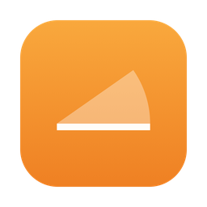
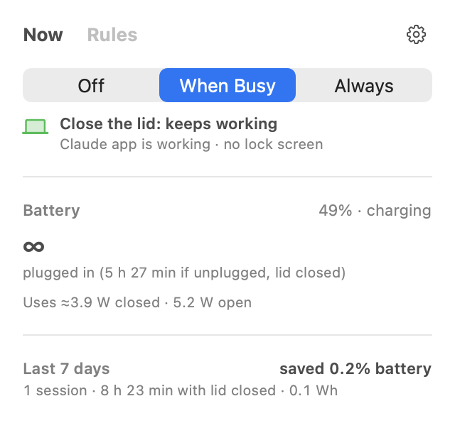
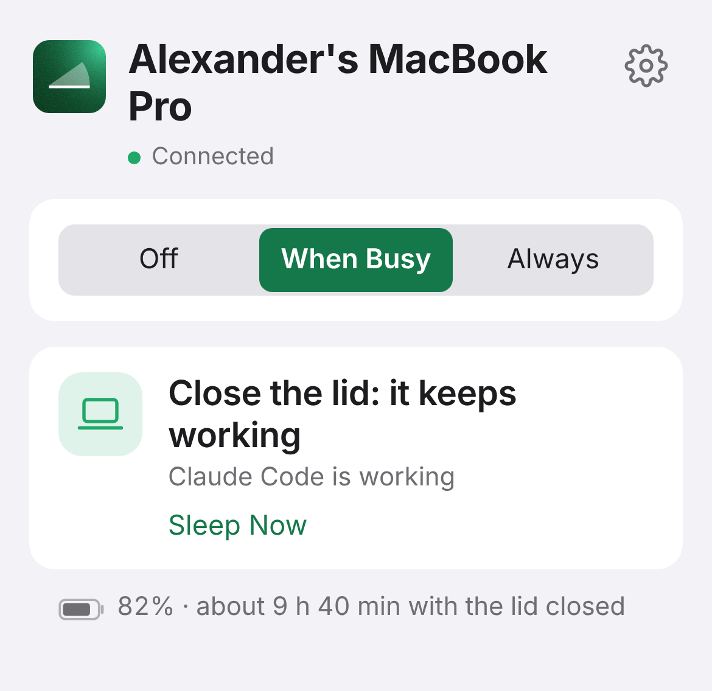

# Nocturnal

**Close the lid. Your AI keeps working.**

Nocturnal keeps your laptop awake with the lid shut while your AI agents work, then lets it sleep. Free and open source, for macOS 14+. Windows 10/11 and Linux (systemd) are in beta.

With the lid shut it pauses apps you aren't using and turns on Low Power Mode. In one test on an M5 Max with iOS simulators open it went from 18.3 W to 3.1 W; yours will differ, and `nocturnal power test` measures your own.

## Install

- **Mac:** `brew install --cask 12alexanderbell-graham/ajar/nocturnal`, or download from https://nocturnal.tools
- **Windows / Linux:** download from the same page (Linux: unpack, run `./install.sh`).
- **Connect your agent:** `nocturnal connect`, then paste the output of `nocturnal prompt` into Claude Code or Codex.

 &nbsp; 

## What it does

- **Off, When Busy or Always.** When Busy keeps it awake while an agent works and sleeps a few minutes after.
- **Knows what Claude Code is doing.** Claude Code's own hooks tell Nocturnal when it's working, waiting for your approval, or finished, so a quiet two-hour build still counts and a question waiting for you doesn't look like "done". Other agents are detected from their power use and running commands.
- **Apps tab.** What keeps it awake (add any app with +), what closing the lid slows or pauses, the battery limit, and a rule per app.
- **Saves power with the lid shut.** Pauses other apps, simulators and silent audio, turns on Low Power Mode. Opening the lid puts it all back.
- **Measures it.** `nocturnal power test` reads whole-laptop power from the battery controller.
- **Agents can use it.** MCP server and CLI, so agents keep the laptop awake for long jobs.
- **Phone page.** Check on it from anywhere, end-to-end encrypted over ntfy.sh. While it sleeps with the lid shut it can check in every 15–60 minutes, so a Wake from the phone gets through.
- **Wakes on a schedule.** `nocturnal wake-at 07:00` wakes it from sleep and keeps it awake a while.
- **Approve everything (optional, risky).** One switch sets Claude Code and Codex to run without asking, in every project, until the work finishes (or a set time, or until you turn it off); then your settings come back. Only you can turn it on, in Nocturnal itself. It never answers macOS's own permission prompts.
- **Battery and heat limits.** Sleeps at your battery limit or if it gets too hot. Agents can't loosen these.

## Is it safe to give it sudo?

On the Mac, Setup adds a sudoers rule for an exact list of commands and nothing else: `pmset` for sleep on/off, Low Power Mode, `sleepnow` and scheduled wakes, `tmutil enable/disable`, and removing that same rule (see `Setup` in [`mac/Nocturnal/System.swift`](mac/Nocturnal/System.swift)). Any program running as you can use those commands too, so the rule stops accidental changes, not a malicious program on your account.

Every change is written to disk before it's made, and a watchdog puts everything back if Nocturnal crashes or hangs, even if the app itself has been deleted. If sleep was already switched off before Nocturnal, it's left that way. Delete the app and the watchdog removes the sudoers rule and itself within 10 minutes; Settings › General › Remove Nocturnal does it at once. `nocturnal rescue` puts everything back by hand. Windows uses power requests and your power plan's lid setting; Linux uses a logind inhibitor.

## Repository

- [`mac/`](mac/): the macOS app (Swift, SwiftUI). Open `mac/Nocturnal.xcodeproj`, or run `mac/install.sh`. Signed and notarized release: `mac/release.sh TEAMID`.
- [`windows-linux/`](windows-linux/): the Windows and Linux app (Rust). `cargo build --release`; tests: `cargo test`, `sh tests/e2e-linux.sh`.
- [`site/`](site/): the website and the phone page (`site/remote/`).
- For agents: [`site/llms.txt`](site/llms.txt) lists every command, MCP tool and setting.

## How the code is organised

Both apps follow the same shape: a decision loop that reads the machine and decides whether to hold it awake, thin platform layers that make the actual changes (each journaled to disk first), and a watchdog that puts everything back if the app dies.

**Mac** ([`mac/Nocturnal/`](mac/Nocturnal/))

| File | What it does |
|---|---|
| `Engine.swift` | The loop: every 2 s reads the lid, battery and agents, decides, starts or ends the hold |
| `Engine+Agents.swift`, `Agents.swift`, `AgentEvents.swift` | Finding agents and whether they're working; Claude Code's hook reports |
| `Engine+ClosedLid.swift` | With the lid shut: dark screen, Low Power Mode, slowing or pausing other apps |
| `Engine+Savings.swift` | What the savings are worth, the power test, battery estimates |
| `Engine+Wake.swift`, `Wake.swift` | Scheduled wakes and phone check-ins while asleep |
| `System.swift`, `Journal.swift` | `pmset`, the sudoers setup, the crash journal and the watchdog |
| `AutoApprove.swift`, `AIConnect.swift` | Approve everything; connecting Claude Code, Codex and the Claude app |
| `Remote.swift` | The encrypted phone link |
| `CLI.swift`, `Commands.swift` | The `nocturnal` command and the MCP server |
| `StatusController.swift`, `MenuPanel.swift`, `SettingsView.swift`, `FirstRun.swift` | The menu bar panel |

**Windows and Linux** ([`windows-linux/src/`](windows-linux/src/))

| File | What it does |
|---|---|
| `engine/mod.rs` | The loop and the decision; `engine/{agents,closed_lid,wake,figures,commands}.rs` hold the rest |
| `engine/tests.rs` | The engine against a mock operating system: every rule and failure path |
| `agents.rs`, `events.rs` | Finding agents; Claude Code's hook reports |
| `platform/{windows,linux}.rs` | Power requests, lid settings, logind, pausing and slowing apps |
| `approve.rs`, `ai.rs` | Approve everything; connecting agents |
| `remote.rs`, `mcp.rs` | The phone link and the MCP server |
| `bin/app.rs`, `bin/cli.rs`, `menu.rs` | The tray app, the `nocturnal` command, the tray menu |

## License

MIT
